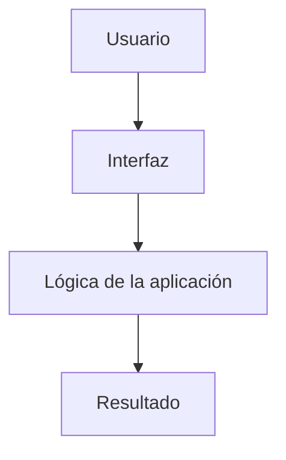

# Skill: Generador de README completo para repositorios GitHub

## 1. Objetivo

Genera o mejora el `README.md` situado en la raíz del repositorio para que una persona que llega por primera vez pueda:

1. Entender rápidamente qué es el proyecto, qué problema resuelve, para quién está hecho y qué valor aporta.
2. Ver sus funciones principales y, cuando corresponda, capturas reales, una demostración o un diagrama.
3. Comprender cómo funciona el sistema y cómo se organiza el código.
4. Instalarlo, configurarlo, ejecutarlo, probarlo y desplegarlo siguiendo instrucciones verificables.
5. Conocer requisitos, variables de entorno, decisiones técnicas, limitaciones, seguridad y estado del proyecto.
6. Saber dónde encontrar documentación adicional, cómo contribuir y bajo qué licencia se distribuye.

La meta es crear documentación **completa, fiel al repositorio, útil para usuarios y desarrolladores, visualmente clara y lista para publicarse**. No se debe confundir “completo” con añadir secciones de relleno: cada sección debe aportar información específica del proyecto.

## 2. Reglas no negociables

- **Investiga antes de redactar.** No escribas el README basándote únicamente en el nombre del repositorio, su descripción de GitHub o las instrucciones de Copilot.
- **Describe el proyecto real.** Contrasta la documentación con el código, los archivos de configuración, los manifiestos, los scripts y las pruebas.
- **No inventes nada.** No afirmes que existe una función, integración, API, prueba, despliegue, compatibilidad, métrica o estado si no hay evidencia suficiente.
- **No inventes comandos.** Obtén los comandos de archivos como `package.json`, `pyproject.toml`, `Makefile`, `Cargo.toml`, `go.mod`, workflows o documentación existente. Comprueba que el comando y su propósito coincidan.
- **No declares pruebas exitosas si no se ejecutaron.** Distingue entre pruebas disponibles, pruebas ejecutadas en esta sesión y resultados documentados anteriormente.
- **No inventes capturas ni enlaces.** Usa recursos visuales presentes en el repositorio o capturas reales de la aplicación cuando sea viable. No utilices imágenes aleatorias o decorativas que hagan creer que representan el proyecto.
- **No inventes badges.** Añade solo badges cuyas URL, workflow, paquete, licencia o destino puedan verificarse. Omite los que no correspondan.
- **No filtres secretos.** Nunca copies valores de `.env`, credenciales, tokens, claves privadas, contraseñas ni información sensible. Puedes leer nombres de variables de `.env.example` o archivos equivalentes; no reproduzcas valores secretos.
- **No presentes inferencias como hechos.** Cuando algo sea razonable pero no esté confirmado, omítelo o identifícalo expresamente como inferencia.
- **Respeta el idioma del proyecto.** Conserva el idioma del README existente cuando sea coherente. Si no existe, elige el idioma predominante en la documentación del proyecto; si no puede determinarse, usa español claro.
- **Respeta el alcance.** Modifica el `README.md` raíz. No refactorices código ni cambies la configuración del proyecto para hacer que la documentación parezca funcionar. Los recursos de documentación nuevos solo se crean si son necesarios y pueden generarse de forma fiable.
- **Evita afirmaciones promocionales vacías.** Prefiere explicaciones demostrables, ejemplos concretos y límites explícitos frente a expresiones como “el mejor”, “revolucionario” o “100 % seguro”.

## 3. Investigación del repositorio

Realiza una inspección sistemática. Si una ruta no existe, continúa con las demás; no supongas que todos los proyectos tienen la misma estructura.

### 3.1. Documentación e instrucciones de Copilot

Lee, cuando existan:

- Archivos con nombres o propósitos equivalentes a `Architecture`, `Code_Exemplars`, `Coding_Standards`, `Project_Folder_Structure`, `Technology_Stack`, `Unit_Tests` y `Workflow_Analysis`.
- Documentación de `docs/`, archivos `CONTRIBUTING`, `CHANGELOG`, `SECURITY`, `CODE_OF_CONDUCT` y guías del proyecto.
- El `README.md` actual, si ya existe, para conservar información válida y detectar huecos o contradicciones.

Las instrucciones de Copilot son una fuente importante, pero **no sustituyen la inspección del código real**.

### 3.2. Manifiestos, configuración y automatización

Identifica los archivos aplicables al proyecto, por ejemplo:

- JavaScript/TypeScript: `package.json`, archivos de lock, configuración de framework, TypeScript, lint, formato y pruebas.
- Python: `pyproject.toml`, `requirements*.txt`, `Pipfile`, `setup.py`, `tox.ini` y configuración de pruebas.
- Java/Kotlin: `pom.xml`, `build.gradle`, `gradlew` y configuración relacionada.
- .NET: archivos `.sln`, `.csproj` y configuración de paquetes.
- Go: `go.mod`, `go.sum`, `Makefile` y comandos de compilación.
- Rust: `Cargo.toml`, `Cargo.lock` y configuración de pruebas.
- PHP: `composer.json` y `composer.lock`.
- Ruby: `Gemfile`, `Gemfile.lock` y `.gemspec`.
- Aplicaciones móviles, infraestructura, contenedores y datos: archivos de proyecto, Docker, Compose, Terraform, Helm, workflows y scripts que realmente existan.
- CI/CD: `.github/workflows/` y las configuraciones equivalentes de la plataforma utilizada.

Registra las versiones, los scripts disponibles, los puntos de entrada, los comandos de compilación y los requisitos que se puedan confirmar.

### 3.3. Código fuente y pruebas

Inspecciona el código suficiente para conocer:

- El punto de entrada de la aplicación o biblioteca.
- Los módulos, componentes, servicios, rutas, comandos o paquetes principales.
- Las interacciones entre las partes relevantes.
- Los flujos de usuario o flujos de datos principales.
- Los modelos, esquemas, tipos, persistencia e integraciones, cuando proceda.
- Los mecanismos de autenticación, autorización, validación, errores y registro, si existen.
- Las pruebas disponibles, su ubicación y cómo se ejecutan.

Usa las pruebas como evidencia para confirmar comportamientos y ejemplos. No asumas que todos los archivos del árbol de directorios representan funcionalidades terminadas.

### 3.4. Recursos visuales y metadatos

Busca recursos útiles en rutas como `docs/`, `docs/capturas/`, `docs/images/`, `screenshots/`, `assets/`, `public/` y carpetas equivalentes. Examina también el icono, el logo, los GIF, los vídeos de demostración y otros medios existentes.

Revisa, cuando estén disponibles, el archivo `LICENSE`, metadatos del repositorio, versiones o etiquetas, enlaces de demo, configuración de despliegue y documentación pública asociada.

### 3.5. Jerarquía para resolver contradicciones

Cuando dos fuentes discrepen, no combines los datos sin comprobarlos. Prioriza, según el tipo de información:

1. **Comportamiento actual:** código y pruebas relevantes.
2. **Comandos, dependencias y scripts:** manifiestos y configuración ejecutable.
3. **Motivos y decisiones de diseño:** documentación de arquitectura y explicaciones explícitas del proyecto.
4. **Intención y contexto:** instrucciones de Copilot, issues, notas de desarrollo y roadmap.
5. **README existente y descripción del repositorio:** como punto de partida, no como autoridad absoluta.

Si no puedes resolver una contradicción importante, evita la afirmación dudosa y anota la incertidumbre en la respuesta final al usuario.

## 4. Plan de análisis antes de redactar

Antes de escribir, elabora internamente un resumen breve con:

- Nombre, propósito, problema que resuelve y público objetivo.
- Tipo de proyecto: aplicación web, API, CLI, librería, móvil, escritorio, herramienta de datos, infraestructura u otro.
- Funcionalidades verificadas y flujo principal de uso.
- Stack tecnológico y función de cada tecnología.
- Requisitos y ruta mínima para ejecutarlo.
- Comandos comprobados o declarados en la configuración.
- Arquitectura y archivos/carpetas clave.
- Variables de configuración que sean necesarias, sin valores secretos.
- Pruebas, estrategia de CI/CD y métodos de despliegue que existan.
- Imágenes, capturas, demo y diagramas disponibles.
- Licencia, limitaciones conocidas, estado actual y mejoras futuras documentadas.
- Información que no se ha podido confirmar.

Este análisis sirve para evitar omisiones y no debe sustituir al README final.

## 5. Estructura del README

Adapta el índice al tipo y tamaño del proyecto. Incluye las secciones relevantes y desarrolla el contenido con suficiente profundidad. No incluyas secciones irrelevantes solo por completar una plantilla.

### 5.1. Cabecera y primera impresión

Cuando los recursos y datos existan, incluye:

- Logo o imagen representativa del propio proyecto, centrado si encaja con el estilo.
- Título con el nombre oficial del proyecto.
- Una frase breve que explique qué hace y para quién.
- Badges relevantes: licencia, workflow de integración continua, versión publicada, cobertura o paquete, solo si pueden verificarse.
- Enlaces funcionales a demo, documentación, instalación, ejemplos o página del proyecto.

La primera pantalla del README debe comunicar el propósito sin obligar al lector a recorrer todo el documento. No añadas una larga fila de badges irrelevantes.

### 5.2. Tabla de contenidos

Para READMEs medianos o largos, crea una tabla de contenidos con enlaces a los encabezados existentes. Comprueba que cada enlace coincide con el texto final y con la forma en que GitHub genera sus anclas. No incluyas referencias a secciones inexistentes.

### 5.3. Resumen del proyecto

Explica con claridad:

- Qué es el proyecto.
- Qué problema o necesidad resuelve.
- A quién va dirigido.
- Cómo se utiliza a alto nivel.
- Qué lo distingue dentro del alcance que realmente implementa.

No te limites a repetir la descripción corta del repositorio. Explica el propósito con información concreta.

### 5.4. Demostración, capturas y material visual

Incluye una sección visual cuando tenga sentido para el tipo de proyecto.

- Prioriza capturas reales de las pantallas principales, del flujo central y de los resultados que produce el proyecto.
- Si ya existen imágenes útiles, reutilízalas antes de crear otras.
- Prefiere rutas relativas al repositorio, por ejemplo `docs/capturas/pantalla-principal.png`, para que las imágenes sigan funcionando al clonar el proyecto.
- Usa texto alternativo descriptivo, como ``.
- Añade un pie o una breve explicación si no resulta evidente qué demuestra la imagen.
- Para varias capturas, organízalas con subtítulos o grupos simples. Evita tablas estrechas que dificulten la lectura en móvil.
- Si existe una demo pública, verifica el enlace antes de añadirlo.
- Si existe un GIF o vídeo auténtico y útil, enlázalo o incrústalo cuando GitHub lo admita y el tamaño sea razonable.
- Nunca uses una captura de otro producto como si perteneciera al proyecto.
- No añadas enlaces rotos ni marcadores como `TODO: poner captura` en el README terminado.

Si no hay capturas y el entorno permite ejecutar la aplicación con seguridad, considera obtener capturas reales siguiendo los comandos documentados y usando herramientas de navegador disponibles. No instales herramientas nuevas, no cambies el código ni dependas de servicios externos sin necesidad o autorización. Si no se pueden generar capturas reales, no las simules: puedes usar un diagrama Mermaid fiel a la arquitectura o explicar al usuario qué capturas convendría añadir más adelante.

### 5.5. Funcionalidades principales

Describe las funcionalidades por áreas o flujos, no como una lista superficial de nombres.

Para cada función relevante, explica cuando corresponda:

- Qué permite hacer.
- Cómo se utiliza.
- Qué resultado produce.
- Qué opciones, restricciones o comportamientos especiales presenta.
- Cómo se relaciona con otras partes del sistema.

Utiliza subsecciones para agrupar funciones relacionadas. Resalta las capacidades que definen al proyecto y diferencia claramente las funciones terminadas de las previstas.

### 5.6. Flujo de uso o ejemplo práctico

Explica un recorrido típico desde el inicio hasta obtener el resultado principal. Usa pasos numerados si facilitan la comprensión.

Incluye ejemplos de entrada y salida cuando sean útiles. Para una CLI o API, incluye comandos, solicitudes y respuestas reales o esquemáticos claramente etiquetados. Para una web, describe el flujo de usuario y enlaza capturas relevantes. Para una librería, incluye el ejemplo mínimo que permita utilizarla.

### 5.7. Arquitectura y funcionamiento interno

Explica la arquitectura con el nivel de detalle que ayude a entender o mantener el proyecto:

- Componentes o capas principales y sus responsabilidades.
- Relaciones entre módulos y cómo colaboran.
- Flujo de datos o secuencia de una operación importante.
- Integraciones externas, almacenamiento, base de datos, API o servicios, cuando existan.
- Decisiones técnicas relevantes y sus motivos, si están documentados o se deducen claramente del diseño.

Incluye un diagrama Mermaid cuando el sistema tenga una relación o flujo que se entienda mejor de forma visual. El diagrama debe representar únicamente componentes y conexiones confirmados. No inventes microservicios, bases de datos, colas, procesos ni proveedores.

Ejemplos de formatos Mermaid posibles:

El ejemplo anterior es solo una plantilla sintáctica. **No lo copies literalmente a un proyecto sin comprobar que sus componentes representan la arquitectura real.**

### 5.8. Stack tecnológico

Incluye una tabla con tecnología, versión confirmada cuando esté disponible, responsabilidad y motivo de uso cuando pueda explicarse con evidencia.

No enumeres únicamente logos o nombres. Distingue, por ejemplo, entre framework principal, lenguaje, estilos, persistencia, herramientas de pruebas, compilación, despliegue y dependencias importantes. No afirmes que se usa una tecnología por encontrarla en un archivo de documentación obsoleto si no aparece en el proyecto actual.

### 5.9. Requisitos previos

Enumera los requisitos mínimos comprobables para instalar y ejecutar el proyecto: runtime, gestor de paquetes, base de datos, navegador, herramientas del sistema, variables necesarias, servicios externos u otros.

Aclara versiones mínimas cuando la configuración las determine. No conviertas versiones probadas en requisitos absolutos si no lo son; distingue entre “requerido” y “probado con”.

### 5.10. Instalación y puesta en marcha

Proporciona instrucciones reproducibles y en el orden correcto:

1. Obtener el código, usando la URL real del repositorio cuando esté disponible.
2. Instalar dependencias con el gestor adecuado.
3. Preparar servicios, base de datos o archivos iniciales, si hacen falta.
4. Configurar variables de entorno.
5. Iniciar el proyecto.
6. Indicar la URL, puerto, ruta o resultado esperado, únicamente cuando se pueda confirmar.

Usa bloques de código específicos para los comandos. Incluye alternativas de instalación o Docker solo si el proyecto las soporta realmente. Aclara desde qué directorio ejecutar los comandos cuando no sea obvio.

### 5.11. Configuración y variables de entorno

Documenta solo las variables y opciones que se hayan encontrado en el código, en archivos de ejemplo, en esquemas o en la documentación del proyecto.

Cuando sea útil, utiliza una tabla con:

| Variable | Obligatoria | Descripción | Valor por defecto |
| --- | --- | --- | --- |
| `NOMBRE_VARIABLE` | Sí/No | Propósito confirmado | Valor por defecto confirmado o `Sin valor por defecto documentado` |

No inventes valores por defecto. No incluyas secretos ni valores reales privados. Si existe `.env.example`, documenta cómo copiarlo y rellenar los valores localmente sin reproducir credenciales.

### 5.12. Comandos disponibles

Resume los comandos reales para desarrollo, compilación, pruebas, lint, formato, análisis estático, generación de documentación y despliegue si están configurados.

Incluye una frase por comando explicando qué hace. Separa los comandos necesarios de los opcionales. No añadas comandos ficticios ni asumas scripts convencionales como `start`, `dev`, `test` o `build` sin verificarlos.

### 5.13. Uso, API o interfaz

Adapta esta sección al producto:

- **Aplicación web/móvil/escritorio:** cómo se usa la interfaz, rutas o pantallas principales, acciones disponibles y flujos relevantes.
- **API:** autenticación, endpoints, parámetros, cuerpos de solicitud, códigos de respuesta y ejemplos verificados. No publiques endpoints secretos.
- **CLI:** sintaxis, comandos, argumentos, opciones, ejemplos y salidas relevantes obtenidos de la implementación o de la ayuda real.
- **Librería/SDK:** instalación, importaciones y ejemplos mínimos con firmas públicas reales.
- **Herramienta de datos/ML:** formato de entrada, preparación de datos, ejecución, salida y evaluación, si corresponde.
- **Infraestructura:** recursos gestionados, requisitos, variables y forma segura de aplicar o retirar cambios.

No fuerces una sección de API si el proyecto no expone ninguna.

### 5.14. Estructura del repositorio

Muestra un árbol de las carpetas y archivos realmente relevantes. Añade comentarios cortos para explicar la responsabilidad de las piezas principales.

- No copies todo el árbol si vuelve ilegible el README.
- No incluyas directorios generados, cachés, dependencias instaladas o archivos irrelevantes.
- Conserva los nombres reales de rutas y archivos.
- Incluye la estructura profunda cuando ayude a entender la arquitectura.

### 5.15. Modelo de datos, persistencia e integraciones

Incluye esta sección cuando corresponda. Explica de forma segura y concisa:

- Entidades o modelos principales.
- Qué datos se guardan, dónde y durante cuánto tiempo si está documentado.
- Cómo se importan, validan, transforman o exportan los datos.
- Integraciones externas y la responsabilidad de cada una.
- Formatos de archivo o contratos de datos importantes.

No expongas datos personales reales, registros privados ni contenido sensible del repositorio.

### 5.16. Pruebas y calidad

Documenta:

- Herramientas y tipos de pruebas encontrados.
- Cómo ejecutar las pruebas.
- Qué módulos o comportamientos cubren, cuando se pueda determinar.
- Cómo se ejecutan lint, formato o análisis estático si existen.
- La integración con CI y sus condiciones, si se ha verificado.

Separa los hechos comprobados de los objetivos. No inventes porcentajes de cobertura. Solo publica un resultado de ejecución como “pasa” si realmente se ejecutó y obtuvo ese resultado; de lo contrario, explica que el comando está configurado pero no fue ejecutado durante la elaboración del README.

### 5.17. Despliegue y publicación

Incluye instrucciones para desplegar únicamente los destinos soportados por el repositorio o la documentación fiable: por ejemplo, Docker, un hosting estático, un servidor, un paquete o una plataforma cloud.

Explica el build de producción, los archivos generados, las variables necesarias y los requisitos de publicación cuando estén confirmados. Diferencia despliegues configurados en el repositorio de posibilidades genéricas que aún no se hayan probado.

### 5.18. Seguridad, privacidad y tratamiento de datos

Cuando sea relevante y exista evidencia, explica:

- Dónde se procesa y almacena la información.
- Qué servicios externos reciben datos.
- Cómo se gestionan credenciales y secretos.
- Controles de autenticación, autorización o validación presentes.
- Cómo reportar vulnerabilidades si hay una política de seguridad.

No prometas que el proyecto es “seguro”, “privado” o “anónimo” de forma absoluta. Formula las afirmaciones con precisión y solo con evidencia técnica.

### 5.19. Limitaciones y decisiones técnicas

Describe las restricciones relevantes y las decisiones que una persona usuaria o desarrolladora deba conocer: compatibilidades, límites de almacenamiento, funcionalidades ausentes, compromisos de diseño o diferencias entre entornos.

Explica el motivo cuando esté documentado. No disfraces limitaciones conocidas ni inventes justificaciones para decisiones cuyo motivo no está claro.

### 5.20. Solución de problemas y preguntas frecuentes

Añade solo preguntas probables y respuestas basadas en incidencias o limitaciones reales. Prioriza problemas de instalación, configuración, ejecución, permisos, puertos, dependencias o exportación que estén documentados.

No inventes errores ni soluciones. Si no hay incidencias conocidas y la sección no añade valor, omítela.

### 5.21. Estado, roadmap y trabajo pendiente

Distingue claramente entre:

- Funcionalidades implementadas y verificadas.
- Trabajo en curso, si se puede confirmar.
- Mejoras futuras documentadas en issues, TODO/FIXME o notas del proyecto.

No conviertas una idea o inferencia en un compromiso oficial. Ordena las tareas futuras si hay una prioridad explícita. Si no existe un roadmap fiable, omite esta sección en lugar de inventar uno.

### 5.22. Contribución y estándares de desarrollo

Explica cómo preparar el entorno, ejecutar verificaciones, proponer cambios y abrir un pull request siguiendo las guías que existan. Enlaza `CONTRIBUTING.md`, código de conducta y estándares si están presentes.

No inventes una estrategia de ramas, formato de commits, proceso de revisión ni requisito de aprobación. Si no hay guía formal, ofrece solo indicaciones mínimas que puedan deducirse claramente del flujo real y sepáralas de las reglas oficiales.

### 5.23. Licencia, créditos, soporte y contacto

- Comprueba el archivo `LICENSE` y usa el nombre de licencia que realmente indica.
- Enlaza atribuciones, dependencias de terceros o proyectos de referencia cuando corresponda.
- Incluye autores, organización, soporte, web o contacto únicamente si están publicados expresamente para ese propósito.
- No extraigas ni publiques direcciones de correo personales de archivos que no estén destinadas a documentación pública.
- Si no existe licencia, no asumas que el proyecto es MIT ni que permite reutilizarse libremente. Indica únicamente que no se ha encontrado un archivo o declaración de licencia, si esa información es útil.

## 6. Estilo visual y calidad de Markdown

Toma como referencia el enfoque de READMEs profesionales que combinan una presentación clara con documentación técnica detallada:

- Título claro y descripción breve en la parte superior.
- Identidad visual coherente y badges moderados.
- Capturas reales que expliquen el producto, con texto alternativo y rutas funcionales.
- Tabla de contenidos en documentos largos.
- Encabezados jerárquicos (`#`, `##`, `###`) sin saltos arbitrarios.
- Párrafos claros y concretos, listas para pasos y tablas solo cuando mejoren la comparación.
- Bloques de código con el lenguaje indicado (`bash`, `json`, `ts`, `python`, etc.).
- Enlaces relativos a archivos internos del repositorio y enlaces externos correctos.
- Diagramas Mermaid simples cuando ayuden a comprender arquitectura o flujos.
- Emojis con moderación; no sustituyen los títulos ni la información importante.
- Evita párrafos excesivamente largos, repetición de contenido, texto genérico y detalles internos que no aporten al usuario.

El README puede ser extenso si el proyecto lo justifica. Prioriza la lectura por capas: una introducción útil al principio y los detalles para quienes quieran profundizar más abajo.

## 7. Badges: criterios concretos

Incluye únicamente los badges pertinentes y con destino válido:

- **Licencia:** solo si se ha identificado una licencia en el repositorio.
- **Build/CI:** solo si existe un workflow o integración real y puede formarse una URL correcta.
- **Versión/release:** solo si existe un paquete o una release con fuente verificable.
- **Cobertura:** solo si hay una fuente real que publique cobertura.
- **Descargas, estrellas, forks u otras métricas:** solo si el origen corresponde al repositorio o paquete correcto y aporta valor.
- **Tecnologías:** opcional; no llenes la cabecera con iconos redundantes.

No uses un badge “build passing”, “tests passing”, “code quality” o “coverage” como decoración. Si no puedes verificarlo, omítelo.

## 8. Verificación final obligatoria

Antes de terminar, revisa el README completo con esta lista:

- [ ] El nombre del proyecto y su descripción son correctos.
- [ ] El problema, público objetivo y propósito quedan claros.
- [ ] Las funciones descritas existen en el código o están respaldadas por documentación fiable.
- [ ] La arquitectura y el diagrama no inventan componentes ni conexiones.
- [ ] El stack y sus versiones coinciden con los archivos reales.
- [ ] Los requisitos previos están claros.
- [ ] Los comandos de instalación, desarrollo, pruebas y build existen y tienen sentido en el contexto del proyecto.
- [ ] Los pasos de configuración no filtran secretos y no incluyen valores falsos.
- [ ] Todas las capturas y las rutas locales de imágenes existen; el texto alternativo es útil.
- [ ] Todos los enlaces importantes apuntan a destinos reales o a archivos que existen.
- [ ] El índice y sus anclas corresponden a los encabezados finales.
- [ ] La estructura de carpetas y los nombres de archivo son reales.
- [ ] Las pruebas, badges, cifras y métricas no se presentan como verificadas sin evidencia.
- [ ] Las limitaciones y el roadmap se distinguen de las funciones implementadas.
- [ ] La licencia y los créditos son correctos.
- [ ] No se han añadido marcadores vacíos, enlaces inventados, ejemplos engañosos ni secciones de relleno.
- [ ] El contenido se adapta al tipo de proyecto y está escrito para una persona que llega por primera vez.
- [ ] El formato Markdown es legible en GitHub y la documentación no contiene secretos.

Si hay herramientas disponibles, valida enlaces y rutas locales de imágenes con los medios que ofrezca el entorno. No declares que un enlace externo se comprobó si no fue posible abrirlo.

## 9. Entrega

- Escribe el resultado final en el `README.md` de la raíz del repositorio.
- Si ya había un README, conserva la información útil y correcta, elimina duplicaciones y reorganiza lo necesario. Reescríbelo cuando sea preciso para que la documentación resulte coherente.
- No reemplaces contenido útil por una plantilla genérica.
- No modifiques código fuente, manifiestos ni configuración.
- Si se han creado capturas reales u otros recursos nuevos imprescindibles, guárdalos en una carpeta de documentación apropiada, usa rutas relativas e informa de ello. No crees recursos visuales ficticios.
- Al finalizar, proporciona un resumen breve de las principales secciones añadidas o mejoradas, los archivos modificados y cualquier limitación importante que no haya podido verificarse.

## 10. Principio final

El README debe responder, de manera progresiva, estas preguntas:

**¿Qué es? ¿Para quién sirve? ¿Qué problema resuelve? ¿Qué puedo hacer con él? ¿Cómo se ve o cómo funciona? ¿Cómo lo instalo y uso? ¿Cómo está construido? ¿Cómo lo pruebo y despliego? ¿Qué limitaciones tiene? ¿Cómo puedo contribuir y bajo qué licencia se distribuye?**

Si una pregunta no es relevante para el tipo de repositorio, no fuerces la sección. Si es relevante pero la información no está disponible, no inventes una respuesta: explica la ausencia solo cuando sea útil para quien lee la documentación.
